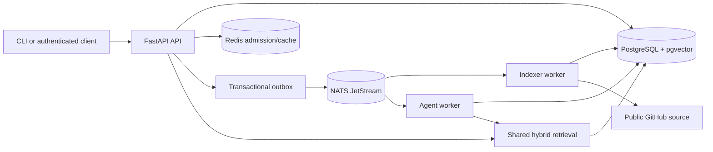

# RepoScope

RepoScope indexes a public GitHub repository at a pinned commit, lets you search its code, and answers questions with file and line citations. It is a single-host, event-driven demonstration of durable jobs and bounded, read-only agent work. The default providers are deterministic mocks, so a local demo requires no model account and makes no paid calls. Mock answers do not establish semantic answer quality.

**Current milestone: T15/T16 source handover; hosted acceptance is open.** The source is synchronized to the owner's [private GitHub repository](https://github.com/supercodingDen/RepoScope). A private `v0.1.0` pre-release exists. The [production configuration](docs/deployment.md), [complete owner setup procedure](docs/manual-configuration.md), and [acceptance ledger](docs/acceptance.md) are prepared, but no public HTTPS deployment or restore/rollback proof exists. The T12 scale study measured 100,029 real source chunks, while its 32-client search p95 target remains open. Read the [current status](docs/project-status.md) before treating a benchmark target as passed.

## Five-minute local path

Use Docker with Compose, Python 3.12.14, and uv 0.12.11. The first run downloads/builds images, Python packages, and tokenizer data, so allow more than five minutes on a cold machine. The small demo is separate from the 100K-chunk benchmark.

1. Run `uv sync --frozen --all-groups` in the repository directory.
2. Copy `.env.example` to `.env` locally. Set **different**, randomly generated hexadecimal values of at least 32 characters for `POSTGRES_PASSWORD`, `APP_DATABASE_PASSWORD`, and `REPOSCOPE_API_TOKEN`. Keep `PROVIDER_MODE=mock` and `ALLOW_PAID_API_CALLS=false`. Never commit or send `.env`.
3. Run `docker compose up --build --wait --wait-timeout 180` and check [health](http://127.0.0.1:8000/healthz) and [readiness](http://127.0.0.1:8000/readyz).
4. Set `REPOSCOPE_API_TOKEN` in the terminal running the CLI to the same token configured locally, then follow the pinned [five-minute demo](docs/demo.md). It imports a small public repository, streams progress, and prints a cited result.

The `migrate` container runs once before the three application roles start. The API binds only to `127.0.0.1`; PostgreSQL, Redis, NATS, management ports, and metrics have no host port. `docker compose down` stops the stack and retains named volumes. See [development](docs/development.md) for Windows setup, upgrades, and troubleshooting, and [configuration](docs/configuration.md) for operator choices.

## Architecture and lifecycle

An accepted import stores its job and outbox event in one database transaction. The worker pins the requested Git revision, acquires source without running its code, chunks and embeds eligible files, then publishes one complete index generation. Search uses scoped vector and full-text candidates with deterministic rank fusion. A run pins that generation; its three read-only tools are `search_code`, `get_file`, and `get_repository_summary`. The agent persists ordered events so an authenticated SSE client can replay from `Last-Event-ID` after reconnecting. PostgreSQL owns business state; Redis is disposable. Leases, fencing tokens, bounded retries, idempotency keys, admission limits, and budget reservations constrain duplicate delivery and resource use. See [architecture](docs/architecture.md), [contracts](docs/contracts.md), and [failure modes](docs/failure-modes.md).

## API and data

Bearer authentication protects `POST /v1/repositories`, `GET /v1/jobs/{job_id}`, `POST /v1/search`, `POST /v1/runs`, `GET /v1/runs/{run_id}`, and `GET /v1/runs/{run_id}/events`. `/healthz` and `/readyz` are unauthenticated. Public `/metrics`, interactive API docs, and OpenAPI routes are disabled; metrics are private. The [versioned public OpenAPI contract](packages/contracts/openapi/public.yaml) and [schema guide](docs/contracts.md) describe payloads and errors. Database migrations live in `src/reposcope/infrastructure/db/migrations`; only the migration role has DDL privileges.

Only canonical public `github.com` repositories are accepted. The indexer filters binary, oversized, generated, and vendor files, records skip reasons, and preserves immutable commit/path/line provenance. Python and TypeScript/TSX use pinned Tree-sitter grammars; other eligible text uses a labeled token/line fallback. No imported repository build, hook, plugin, or source code is executed.

## Evidence and operations

The [T12 performance report](docs/t12-performance.md) includes the corpus manifest, 200 fixed queries, raw measurements, SQL plans, and an 8-CPU isolated database profile. Its shipped HNSW setting reached Recall@10 0.9235 against exact mock-vector neighbors and roughly 80 QPS at 32 active clients, while search p95 was 438–445 ms, above the 100-ms target. Vector-neighbor recall does **not** measure semantic answer relevance. A separate development HTTP health profile missed the 30-ms target. Live-provider search, full-agent latency, and single-job 100K ingestion are still open.

The [operations guide](docs/t10-operations.md) explains private metrics, logs, admission, and a tested fault matrix. [Recovery instructions](docs/failure-modes.md) cover dependency loss, replay, and operator boundaries. [Security](SECURITY.md) and the [T11 review](docs/t11-security.md) describe the current localhost boundary and unresolved image advisories. There is no hosted HTTPS endpoint, backup/restore proof, or production availability claim yet.

## Development and project layout

Run the full offline checks with `uv run --frozen pytest -q`, `uv run --frozen mypy`, `uv run --frozen ruff check .`, and `uv run --frozen ruff format --check .`. Check contract exports with `uv run --frozen python scripts/export_contracts.py --check` and `uv run --frozen python scripts/validate_contracts.py`. The isolated Docker acceptance is `uv run --frozen python scripts/smoke_test.py`; it creates its own disposable volumes and makes no paid calls. See [development](docs/development.md) and [contributing](CONTRIBUTING.md).

`src/reposcope/` holds application roles, services, adapters, and migrations; `contracts/` and `packages/contracts/` hold canonical and exported wire contracts; `scripts/` holds the CLI and checks; `bench/` holds reproducible benchmark programs and manifests; `tests/` holds offline and opt-in integration checks; `docs/` holds the [specification](docs/spec.md), [roadmap](docs/roadmap.md), [ADRs](docs/adr/), [interview guide](docs/interview-guide.md), and verification record. The earlier Go control-plane proposal was superseded by the [documented Python decision](docs/adr/004-python-control-plane.md).

RepoScope source is licensed under [Apache-2.0](LICENSE). See [NOTICE](NOTICE) and [third-party notices](docs/third-party-notices.md). The [T14 release procedure](docs/t14-release.md) and [v0.1.0 notes](docs/releases/v0.1.0.md) describe the private candidate. [T15/T16 source notes](docs/releases/t15-t16.md), [production operations](docs/operations.md), and [project status](docs/project-status.md) record the prepared handover and open gates.
