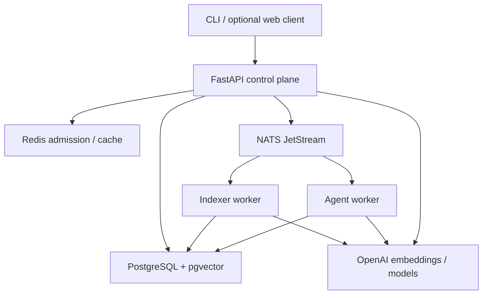

# Architecture

## Decision

Use FastAPI and Python for all application roles. Preserve independent API/indexer/agent process lifecycles and durable event delivery. This supersedes the earlier Go API proposal under the user's explicit architecture delegation. See ADR-004.

The API-to-NATS edge is the outbox publisher after the database commit; it is never a direct dual write in a request handler. The API-to-provider edge is bounded query embedding in live search only. The agent invokes shared retrieval directly rather than calling back through the public API.

## Layering and planned package layout

| Path | Ownership |
| --- | --- |
| src/reposcope/domain/ | Entities, immutable IDs, error categories, state transitions |
| src/reposcope/application/ | Ingest/run orchestration, retrieval, budgets, dependency expansion |
| src/reposcope/ports/ | Typed repository, broker, source, embedding, and model Protocols |
| src/reposcope/adapters/ | PostgreSQL, NATS, Redis, Tree-sitter, Git, and OpenAI implementations |
| src/reposcope/transport/http/ | FastAPI controllers, exception mapping, auth, SSE |
| src/reposcope/workers/ | Indexer and agent entry points; worker exception boundaries |
| src/reposcope/infrastructure/db/migrations/ | Single migration history |
| contracts/ | Canonical Pydantic wire contracts, independent of application workflows |
| packages/contracts/ | Exported OpenAPI, JSON Schema, fixtures, model policy |
| scripts/ | Typed development/validation tools |

Dependencies point inward. Services consume Protocols; the composition root selects adapters. No domain object imports FastAPI, psycopg, Redis, NATS, or OpenAI. Production code is added in T02 onward, not hidden inside contract tooling.

## Source and retrieval pipeline

Acquire a pinned revision, filter files, parse bounded files off the event loop, chunk, embed in batches, and write staged generations. Store bounded source blobs separately from chunks so get_file returns the exact pinned source even when chunks overlap. Reuse embeddings by provider/model/dimensions/preprocessing/content hash without collapsing source locations.

API search and agent search use the same RetrievalService and repositories. Exact and HNSW searches use identical generation and path filters. FTS uses a documented code-friendly tokenizer configuration. RRF ranking is deterministic under ties. A future independent retrieval service is justified only by measured interference/scaling needs.

For report context, select top evidence chunks and up to one hop of statically resolved dependencies. Deduplicate by source span, preserve citations, enforce the aggregate context budget, and leave enough space for instructions, tool schemas, history, and output. The context builder must stop adding evidence before overflow; it cannot send a whole repository.

## Data model and ownership

| Table | Key invariant |
| --- | --- |
| repositories | Canonical URL; active and latest-requested generation pointers |
| index_generations | Immutable source commit, parser/tokenizer/embedding versions; staged/ready/failed/superseded |
| source_files | Unique generation/path; content size bounded |
| chunks | Unique generation/path/ordinal/content_hash; vector(384) |
| dependency_edges | Same-generation, best-effort static source-target references |
| jobs; agent_runs | Visible lifecycle, attempts, principal, deadlines, pinned revision/generation |
| idempotency_requests | Unique principal/route/key; canonical request hash and original response |
| outbox_events | Stable event ID; lease owner and published acknowledgment state |
| consumer_work | Unique consumer/event ID; lease, fencing token, completion marker |
| run_events | Unique run/sequence; append-only replayable safe payload |
| usage_reservations | Atomic estimated/settled/uncertain spend across principals and replicas |

Metadata, task state, outbox, results, and budget records live in PostgreSQL. Redis cache contents may be lost without corrupting authoritative state. Runtime DB users have no DDL permission; migration credentials belong only to the one-shot migration process.

## Deployment boundaries

One host and Compose network initially. HTTPS proxy is public; application and infrastructure networks are restricted. Only the API handles public requests. NATS, Redis, PostgreSQL, metrics, and worker health endpoints have no public bindings. Health/readiness and restart/backup/restore tests are required in T02/T15. This topology is not highly available.

GitHub hosts source, CI, and releases. A Linux host runs the backend. No hosting account has been selected or purchased in T01.
